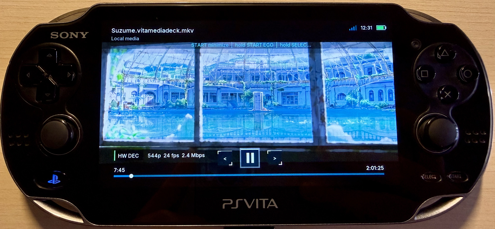

# vita-hw-decoder

Plug-and-play H.264 player backend with optional AAC audio for PlayStation Vita. Video is decoded
by the public `h264_vita`/SceVideodec path and rendered as NV12 surfaces through
vita2d. This package is hardware-only: initialization returns an error instead
of silently falling back to CPU H.264.

<p align="center">
  
</p>
<p align="center"><sub>Current VitaMediaDeck hardware H.264 playback on a physical PlayStation Vita</sub></p>

## 2.0 ABI migration

Version 2 adds `open_with_cancel` to `VitaHwDecoderStreamFactory` and the
non-owning `abort` callback to `VitaHwDecoderStreamHandle`. These additions also
change the layout of `VitaHwDecoderPlayerConfig`. Rebuild every consumer against
the 2.x header and zero- or designated-initialize every public structure,
including each handle returned by a factory; do not reuse a 1.x binary or leave
a stack-allocated factory/handle partially initialized.

```c
VitaHwDecoderStreamFactory source = {0};
VitaHwDecoderPlayerConfig config = {0};
```

## Integrate in three steps

### Experimental live input (`feature/iptv`)

`vita_hw_decoder_live.h` adds a separate opt-in `open_live()` entry point.
The existing 2.x header, public struct layouts and `open()` file-playback
behavior are unchanged. Live transport is supplied by the application, not
implemented inside the decoder:

```c
#include <vita_hw_decoder_live.h>
VitaHwDecoderLiveOptions live = { .size = sizeof(live), .version = 1 };
/* config.stream opens two identical start cursors, with size=-1, NULL seek,
 * cooperative blocking reads and a prompt, non-owning abort callback. */
int result = vita_hw_decoder_open_live(player, &config, &live);
```

V1 accepts multiplexed MPEG-TS with H.264 and mono/stereo AAC, at most 1280x720.
Use zero start position/audio ordinal. Temporary starvation must block
cooperatively rather than return EOF; the transport must bound waiting and
memory. Both cursors must begin at the same retained segment. Non-seekable
AVIO skips tail/duration scans; both demuxers use the video demux's PTS origin.
The live video presentation conversion now subtracts this shared origin before
frame reordering, matching AAC clock normalization. This fixes the startup
rejection seen with a 10.0101-second HLS origin; the ordinary file entry point
continues to pass a zero video offset and its seek/track contracts are unchanged.
Finite HLS VOD can use the same forward-only adapter; the app decides whether
pause resumes in place or reconnects live. Duration/playlist windows stay above
the decoder. Native builds and host timestamp tests are not Vita playback proof.
Seek/track changes return ENOSYS without tearing down live playback. The app
must close both pipelines and reconnect on discontinuity, lag or resume-live.
Codec internals and existing file seek/track-switch recovery remain intact.

VitaMediaDeck host tests validated forward-only demux/decode with the pinned
FFmpeg 6.0 base at a nonzero PTS origin. Native `-O3` compilation passes.
Actual Vita live A/V synchronization, audio output and long-session stability
still require hardware testing; this API is experimental, not broadcast-certified.

The live options also accept `version = 2` for application-remuxed single-program
MPEG-TS. The options remain 16 bytes: the two V1 reserved words are exposed as
`audio.sample_rate` (decoded PCM rate, 8000–48000) and `audio.channels` (1–2)
only in V2. This preserves HE-AAC/SBR output metadata that an ADTS-only probe
may report at the core AAC rate. V1 callers must still leave both words zero.
Only V2 limits optional stream/FPS probing to avoid a low-bitrate startup stall;
V1 HLS and ordinary file-probe settings remain unchanged. No file API/ABI,
seek or track-switch contract is changed by this extension.

### Finite files (unchanged)

```sh
export VITASDK=/path/to/vitasdk
./tools/build-ffmpeg.sh
```

```cmake
set(VITA_HW_DECODER_FFMPEG_ROOT "/path/to/vita-hw-decoder/build/deps/ffmpeg-vita-hw")
add_subdirectory(external/vita-hw-decoder)
target_link_libraries(my_app PRIVATE VitaHwDecoder::VitaHwDecoder)
```

```c
#include <vita_hw_decoder.h>

VitaHwDecoderStreamFactory source = {0};
vita_hw_decoder_file_stream_factory("ux0:video/movie.mp4", &source);
VitaHwDecoderPlayerConfig config = { .stream = source, .volume_percent = 100 };
VitaHwDecoderPlayer *player = vita_hw_decoder_create();
int result = vita_hw_decoder_open(player, &config);
```

Copy `reAvPlayer.suprx` to `app0:modules/reAvPlayer.suprx` in the VPK. The
complete render loop is in `examples/local_file.c`.

## Current playback contract

- H.264 is decoded only by the public `h264_vita`/SceVideodec path; this package
  never hides a CPU fallback. Presentation follows the known-working online
  renderer contract: GXM samples the decoder's NV12/P2 surfaces as `YVU420P2`,
  with the original twenty-surface direct pool and an independent copied ring
  available for startup fallback. The last displayed surface counts as
  available between 24 fps video deadlines so the UI cannot report false
  buffering.
- MOV/MP4 and Matroska sources may contain optional AAC audio. The initial
  zero-based audio ordinal comes from `VitaHwDecoderPlayerConfig.audio_track`;
  an ordinal outside the playable AAC snapshot is clamped to track zero during
  open so stale preferences cannot silently disable audio.
- AAC demux/decode produces into a bounded eight-grain PCM ring. A dedicated
  1024-frame AudioOut consumer runs one scheduler priority above the video
  worker, so H.264, transport, and UI/GXM bursts cannot accumulate into audible
  starvation. The consumer alone publishes the played clock after AudioOut has
  accepted a grain; EOF is not exposed until every queued grain has drained.
  Shutdown diagnostics report submitted grains, delayed refills, and the
  maximum wall-clock refill gap.
- The already-open video demux snapshots up to 16 playable AAC tracks and 16
  embedded text-subtitle tracks (SubRip, ASS/SSA, WebVTT, MOV text, plain text,
  and MicroDVD) before decode starts. `vita_hw_decoder_*_track_count()` and
  `vita_hw_decoder_*_track_info()` expose each stream index, default flag,
  channel count, UTF-8 language/title, and codec name without opening a third
  probe cursor.
- `vita_hw_decoder_select_audio_track()` seeks the already-open audio demux
  cursor and restarts only its AAC/output pipeline at the supplied media
  timestamp. The live video pipeline, pause, and volume state are retained, and
  remote track changes do not reconnect or probe the container again. The
  replacement stays gated until its worker has retained an access unit at or
  after that timestamp. A known target at/after the stream's origin-normalized
  end is rejected before the live worker stops; unknown or sparse tails get a
  1.5-second readiness deadline. An empty/timed-out replacement rolls back to
  the prior track instead of committing a silent cursor.
- Initial playback and in-place seek restarts use that same bounded audio-start
  helper when incomplete AAC metadata requires a synchronous ADTS access-unit
  probe. A timed-out, transport-aborted seek follows the normal checked
  full-session recovery path instead of reusing the poisoned cursor.
- `start_position_ms`, seeking, stream-reported bitrate, duration, decoded/shown
  counters, and dropped-frame counters are exposed through the public config and
  status structures. Runtime seeks reuse the open demuxers and first seek the
  selected H.264 stream backward, preventing sparse subtitle, attachment, or
  cover tracks in Matroska from moving the demuxer to a later cluster. Both the
  video cursor and the independent audio cursor hop through that H.264 Cue index;
  the decoder never seeks the sparse AAC index or falls back to a multi-stream
  linear search. After the byte-level hop, each input exposes only its selected
  H.264 or AAC track while performing the bounded keyframe/interleave preroll.
  Startup and live seek diagnostics report video- and audio-demux time
  separately. They
  feed that preceding keyframe and its
  dependent packets into H.264, and discard only decoded preroll pictures before
  publishing from the requested timestamp. Compressed reference packets are
  never discarded merely because their PTS precedes a backward-seek target.
  Only the decode pipelines are
  rebuilt; after the owner fences GXM and calls
  `vita_hw_decoder_prepare_background_restart()`, the video surfaces use the
  conservative full teardown/reallocation lifecycle proven by the online
  player, avoiding stale GXM or AVFrame ownership across a seek. A
  normal close keeps the conservative render wait, and a full reopen remains
  the recovery fallback for non-cancellation failures. A seek at the reported
  duration is clamped inside the video-stream end by at least 250 ms so the final
  GOP cannot be mistaken for a broken empty startup. Audio is released after the
  first decoded video frame. Startup
  requires that frame within 2.5 seconds and fails cleanly if `h264_vita`
  accepts the stream but produces no picture, allowing an application-level
  Auto policy to reopen the CPU backend. Seek first-frame waits are capped at
  1.5 seconds and return a timeout when no picture exists, rather than releasing
  audio into a permanently empty video queue. A live seek also rejects a first
  ready frame more than two seconds beyond the requested clock. Startup, resume,
  live seek, and audio-track replacement retain the first AAC timestamp and
  require the first audio and video landings to agree within 250 ms before the
  shared start gate opens. Invalid landings invoke the checked fresh-session
  recovery instead of committing offset audio or a black screen. If a selected audio
  stream reaches clean EOF before the
  video, clock ownership moves to the monotonic presentation clock without
  clearing the selected audio pipeline, so position remains continuous, the
  video tail drains, and a later seek can restart that same track. Hidden or
  energy-saving playback can call `vita_hw_decoder_discard_video_to_clock()`
  after fencing GXM to keep the decode queue draining without drawing.
- Stream discovery runs within the configured probe/analyse bounds whenever
  the required H.264/AAC parameters are incomplete, including for indexed MP4
  and Matroska inputs; complete indexed inputs keep the fast path. If an initial
  saved-position seek fails or
  points at/past the reported end, playback performs a checked restart at zero
  rather than decoding linearly through a long file.
- A stream factory can represent a Vita file or an authenticated remote reader,
  but every open call must return a fresh readable, seekable cursor. Existing
  factories can keep using `open`; an optional `open_with_cancel` callback
  receives the per-operation flag so a blocked remote connection/read can stop
  promptly. A handle may additionally provide non-owning `abort` to wake a
  concurrently blocked cursor operation. The decoder calls it only while I/O is
  published active: ordinary seek/track restart first allows a shared 30 ms
  cooperative grace, while explicit stop/close interrupts immediately. It never
  uses `abort` as `close`, and reopens that cursor before a seek or track switch
  because transports may become unusable after abort. The callback must itself
  return promptly; the deadline selects cancellation time but cannot make a
  non-cooperative transport's blocked callback return.
- Caller-owned cancellation is never written or cleared by close. Cancellation
  also suppresses the expensive full-open recovery path; the embedding
  application can leave its loading screen immediately and decide what to do
  next. Audio rollback gets a fresh decoder-owned interrupt phase, so the flag
  that cancelled a replacement cannot also suppress restoration of the prior
  track. The UI delivers the decoder interrupt before publishing its caller
  flag, so a forward cancellation cannot arrive late in rollback; a later
  interrupt or session stop can still terminate a blocked restore. A
  replacement remains gated until
  pause/volume state is installed and its operation-only transport interrupt
  has been cleared. If the new track fails but rollback succeeds, the call
  returns `VITA_HW_DECODER_AUDIO_CHANGE_ROLLED_BACK` and the previous track
  remains live.
- Concise timing records identify factory open, FFmpeg header/probe, startup
  first-frame wait, demux seek, worker join/restart, audio-switch latency, and
  AudioOut refill cadence in the module log for on-device performance checks.

VitaMediaDeck can consume the decoder's immutable track-metadata snapshot while
layering embedded text-subtitle packet demux, cover/frame previews, resume
history, and player UI above this package.

The current VitaMediaDeck integration uses the same H.264 cue anchor for an
initial saved-position resume, a live seek, and AAC track replacement. Subtitle
and thumbnail cursors remain app-owned and use independent cancellation
generations, so restarting grid-cover work cannot invalidate the active media
seek or playback cursor.

## Use both backends in one app

`vita-hw-decoder` and `vita-sw-decoder` use the same lifecycle and stream
contract but have distinct symbols and CMake targets, so they can be linked
together. An application can try `vita_hw_decoder_open()` first, destroy that
session after a non-cancellation failure, then reopen the same stream factory
through the software package. A cancellation result must be returned directly.
`vita_hw_decoder_backend_name()` identifies the package in logs.
`VitaHwDecoderPlayerStatus.video_bitrate_bps` exposes the H.264 stream bitrate
reported by FFmpeg, then the container bitrate. When Matroska advertises neither,
the decoder derives an average from the seekable file size and duration instead
of returning an empty HUD value.
`VitaHwDecoderPlayerConfig.audio_track` selects a zero-based AAC stream
ordinal, and `vita_hw_decoder_select_audio_track()` changes it at the supplied
playback timestamp without interrupting the video decoder or losing pause and
volume state.

The source factory creates two independent seekable cursors (audio and video).
Session startup currently opens and probes the video cursor first so it can
snapshot/select tracks, then opens and probes the audio cursor. These stages are
intentionally serialized because the factory contract guarantees independent
cursors but does not guarantee that concurrent factory calls are thread-safe.
It therefore works with local files and with remote Range readers. Supported
content is a seekable container recognized by the pinned FFmpeg build with H.264
video with optional AAC audio in a MOV/MP4 or Matroska container.

## Install and consume

```sh
cmake -S . -B build/package \
  -DVITA_HW_DECODER_FFMPEG_ROOT="$PWD/build/deps/ffmpeg-vita-hw"
cmake --build build/package
cmake --install build/package --prefix "$PWD/build/stage"
```

Installed consumers may use `find_package(VitaHwDecoder CONFIG REQUIRED)` and
link `VitaHwDecoder::VitaHwDecoder`. The installed package carries its pinned
FFmpeg static archives, license texts and corresponding source, so consumers do
not need to reconstruct its private link path.

## Related repositories

| Repository | Relationship |
| --- | --- |
| [`VitaMediaDeck`](https://github.com/spyro-98/VitaMediaDeck) | Main application and hardware-first/software-fallback orchestrator |
| [`vita-sw-decoder`](https://github.com/spyro-98/vita-sw-decoder) | API-compatible CPU H.264 fallback |
| [`vita-https`](https://github.com/spyro-98/vita-https) | Hardened seekable HTTPS Range source used by WebDAV playback |
| [`VitaMediaDeck-Transcoder`](https://github.com/spyro-98/VitaMediaDeck-Transcoder) | Optional desktop producer of compatible H.264/AAC Matroska files |

Licensed GPL-3.0-only. See `THIRD_PARTY_NOTICES.md` for FFmpeg, wiliwili,
ReAvPlayer and VitaSDK requirements.
